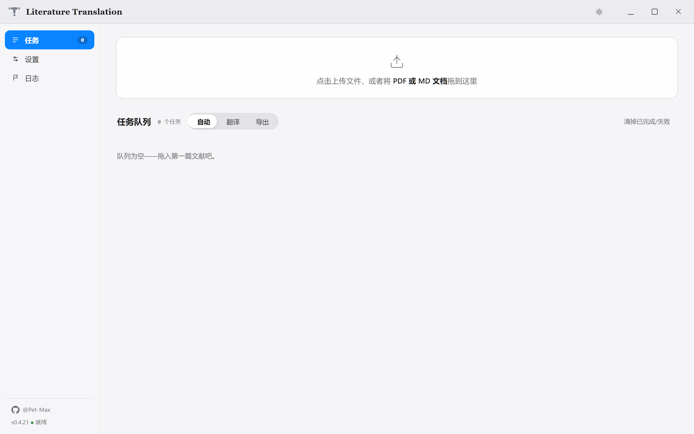
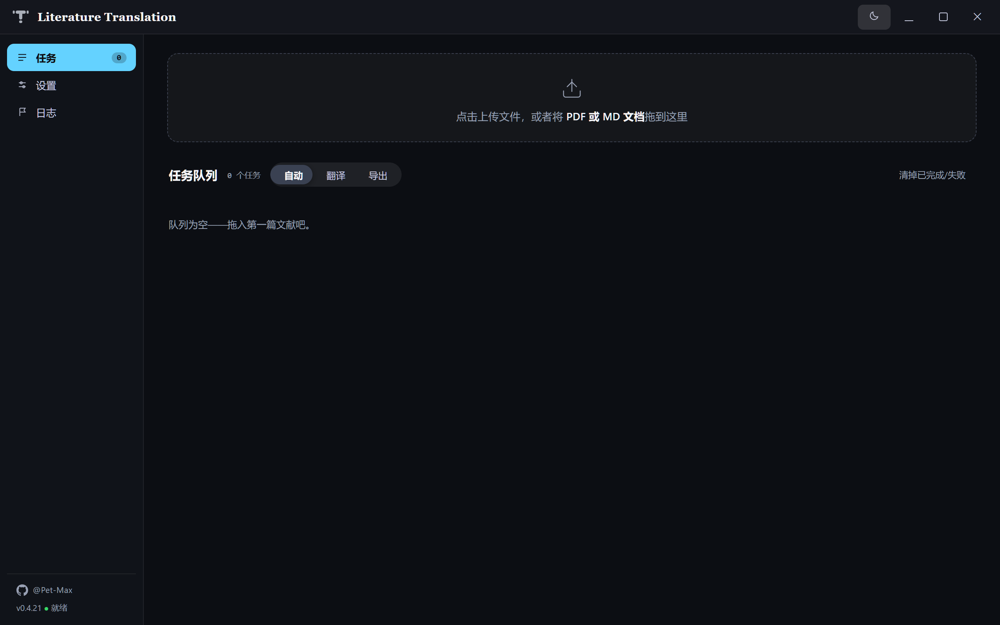

<p align="center"></p>

<h1 align="center">Literature Translation</h1>

<p align="center">
  <a href="https://go.dev"></a>
  <a href="https://www.python.org"></a>
  <a href="https://wails.io"></a>
  <a href="https://github.com/Pet-Max/Literature-Translation/releases"></a>
  <a href="https://github.com/Pet-Max/Literature-Translation/releases/latest"></a>
  <a href="LICENSE"></a>
</p>

Literature Translation 是一个**英文学术文献翻译桌面应用**。拖入 PDF 或 Markdown，自动走「云端解析 → LLM 翻译 → KaTeX 排版导出」全流程，产出一份带公式、图表、参考文献的中文 PDF。翻译完的文献按每篇一个档案夹自动归档，过程文件完整保留。

## 界面预览

| 浅色主题（默认） | 深色主题 |
|:-:|:-:|
|  |  |

## 工作流程

```
拖入文件 → 语言自动路由
  ├─ 英文 PDF  → MinerU 云端精准解析 → 拼写校准 → LLM 翻译 → KaTeX 排版 → 中文 PDF
  ├─ 英文 MD   → LLM 翻译 → KaTeX 排版 → 中文 PDF
  ├─ 中文 MD   → 直接排版导出（换字体 / 开目录重出 PDF）
  └─ 中文 PDF  → 秒拒（不烧配额）
```

**每篇文献的归档结构**

```
Literature Library/
└── L001_Full counting statistics…/
    ├── 01_en_pdf/    原始 PDF
    ├── 02_en_md/     MinerU 解析 + 拼写校准后的英文 MD（含图片）
    ├── 03_zh_md/     中文译文 MD（含图片，双击可看）
    ├── 04_zh_pdf/    最终排版成品
    └── _process/         断点缓存 · MinerU 原始解包 · 来源路径
```

## 主要功能

- **智能路由**：自动按文件语言分流——英文 PDF 走完整流程、英文 MD 直接翻译、中文 MD 仅导出；中文 PDF 在解析前即被拦截，不浪费云端配额
- **公式零损伤**：翻译时用占位符冻结公式（⟦F1⟧），机械校验 $ 配对 / 占位符完整，不合格自动重试；排版用 KaTeX 逐公式渲染，粗体向量 `\boldsymbol` 自动归一
- **多套翻译规则**：预设可编辑、可切换、可重命名，「生效中」徽标实时标注；改名即时落盘，正文编辑有未保存提醒
- **术语表**：原文术语 → 统一译名，附在每段翻译指令中，LLM 严格遵循
- **断点续跑**：每段译文即时落盘，中断后重跑自动跳过已完成段；规则 / 术语 / 模型变更自动使旧缓存失效
- **文献归档**：每篇文献一个档案夹（默认 `程序目录\Literature Library\`，可自定义），四类产物分目录 + 过程文件全保留，重跑同篇覆盖不堆积
- **字体系统**：内嵌霞鹜文楷（译文风）/ 宋体（刊物风）/ 黑体（屏读风）三套预设，支持导入自定义字体，实时预览含 KaTeX 公式
- **连接测试**：MinerU（API Token）与 LLM（模型 API 地址）旁的小图标一键测连通，绿 ✓ 红 ✕ 即时反馈
- **拉取模型**：从上游 `/v1/models` 拉取可用模型列表，弹出可筛选选择框
- **队列控制**：任务不自动跑——「开始」按钮统一调度，支持暂停（当前任务跑完即停）和单卡优先
- **深浅双主题**：曙光白（浅，默认）+ 子夜蓝（深）一键切换，全部组件（含弹窗、滚动条、开关）令牌级适配

## 快速开始

### 下载安装

前往 [GitHub Releases](https://github.com/Pet-Max/Literature-Translation/releases) 下载（发布后两个形态都有）：

- **安装版** `Literature-Translation-Setup-*-windows-amd64.exe`——安装向导、自定义目录、开始菜单与卸载器
- **便携版** `Literature-Translation-*-windows-amd64-portable.zip`——解压即用，程序与归档自包含

### 从源码构建

#### 环境要求

| 组件 | 说明 |
|------|------|
| Windows 10 / 11 | 目前仅支持 Windows（WebView2 与 Edge 系统内置，无需另装） |
| Go 1.26+ | 构建主程序 |
| Python 3.10+ | 翻译引擎（[PyMuPDF](https://pymupdf.readthedocs.io) + [httpx](https://www.python-httpx.org)） |
| [MinerU](https://mineru.net) 账号 | 精准解析 API Token |
| 任意 OpenAI 兼容 LLM | 模型 API 地址 + API Key + 模型名 |

#### 安装依赖

```bash
pip install pymupdf httpx
```

#### 构建

```bash
build.bat
```

产物在 `build/bin/Literature-Translation.exe`

### 首次配置

1. 启动应用，进入「设置 → 服务连接」
2. 填入 MinerU API Token（点「前往 API 管理 ↗」直达获取页）
3. 填入 LLM 模型 API 地址、API Key、模型名（可点「拉取模型」从上游列表选择）
4. 点输入框右侧 ⇄ 图标测试连通，两个 ✓ 就绪
5. 点「保存设置」

### 使用

1. 拖入 PDF 或 MD 文件（多文件可一次拖入）
2. 按需切换入队模式：自动 / 翻译 / 导出
3. 点「开始」——队列串行处理，可暂停 / 单卡优先
4. 完成后点「中文 PDF」打开成品，「打开文件夹」直达归档目录

> **看看效果**：[该文献](samples/example-document-cn.pdf) 是 arXiv 论文（2207.00867）经本应用实际翻译导出的成品——排版、公式、参考文献样式即真实所见。对应的[英文原文](samples/example-document-en.pdf)也可以直接拖进应用，自己跑一遍。

**进阶：用环境变量管理密钥（可选）**

四个凭据字段支持环境变量，且优先级高于配置文件，设置后重启应用生效：

`MINERU_TOKEN`（或 `MINERU_API_TOKEN`）、`LLM_API_KEY`、`LLM_BASE_URL`、`LLM_MODEL`。

注意：若之后在设置页点过「保存设置」，页面回显的值（含环境变量注入的）会写入 `config.json`。

## 常见问题

- **双击 exe 弹出 SmartScreen 警告？** 应用暂未做代码签名（开源项目常见状态），点「更多信息 → 仍要运行」即可。
- **提示找不到 Microsoft Edge？** 导出 PDF 依赖系统 Edge（Win10/11 内置）。若系统被精简过，安装 Edge 即可，无需任何配置。
- **启动提示 Python 相关错误？** 翻译引擎需要 Python 3.10+ 与依赖（`pip install pymupdf httpx`）；也可用环境变量 `LITERATURE_PYTHON` 指定解释器路径。
- **MinerU 报 Token 无效 / A0202？** 到 [mineru.net「API 管理」](https://mineru.net/apiManage/token)重新生成 Token，回设置页粘贴后点输入框右侧 ⇄ 重测。
- **翻译卡住或某段失败？** 先看「日志」视图——解析、重试、导出的全过程都在。个别段最终失败会保留英文原文并标注，处理完直接重跑，自动断点续译。

## 引擎架构

```
┌───────────────────────────────────────────┐
│  GUI (Wails + WebView2)                    │
│  任务队列 · 设置 · 日志 · 主题              │
├───────────────────────────────────────────┤
│  Go 管线层 (internal/pipeline)             │
│  MinerU 解析 · 拼写校准 · 归档 · 渲染导出   │
├───────────────────────────────────────────┤
│  Python 引擎 (engine/)                     │
│  公式冻结 · 分段翻译 · 断点缓存 · 校验重试  │
│  （stdio JSON-RPC 子进程，无窗口）          │
└───────────────────────────────────────────┘
```

## 隐私与安全

- 凭据保存在本机 `%APPDATA%/Literature Translation/config.json`，不上传、不遥测
- 翻译内容仅经过你配置的 LLM 接口和 MinerU 云端，本工具自身不收集任何数据
- 断点缓存只含源段哈希与译文，不含 API Key

## 开发者指南

```
main.go        GUI 入口（Wails v2，go:embed 前端资源）
app/           Wails 绑定层（队列、配置、连接测试；路由测试在此）
cmd/literature-translation/   CLI 入口（与 GUI 共用 internal/pipeline）
internal/      能力包：config / pipeline / engine / mineru / render /
               export / fonts / repair / version（版本号唯一定义）
engine/        Python 翻译边车（stdio JSON-RPC：切段→冻结→翻译→校验→回填）
frontend/dist/ 前端三件套，即源码、零构建（embed 进主程序）
tests/         管线 E2E、前端 E2E、overlay 服务器、gui_shim 模拟壳
build/         图标源与打包产物（bin/ 不入库）
```

### 本地开发

- 改前端直接编辑 `frontend/dist/` 三个文件，无构建步骤；改完 `build.bat` 重新打包（前端经 embed 进 exe）
- 前端 E2E 的 overlay 服务器（`tests/overlay_server.mjs`）直供 dist 并注入 `tests/gui_preview/gui_shim.js`（window.go 的 mock）——**新增 Go 绑定时必须在 shim 里加同名 mock**，否则前端测试挂
- 版本号唯一来源 `internal/version/version.go`，发版只改这一处

### 本地打包

```bat
:: 一次性：下载便携 Python（嵌入式 3.12 + pymupdf/httpx），落 build\runtime\
build\prepare_runtime.bat

:: 之后每次：构建 exe + 组装载荷，产出两种分发物
package.bat
```

产物在 `build\bin\`：`Literature-Translation-Setup-vX.Y.Z-windows-amd64.exe`（安装版）与 `Literature-Translation-vX.Y.Z-windows-amd64-portable.zip`（便携版）。载荷 = 主 exe + engine\*.py + 便携运行时，两版同源。

### 质量门禁

三层测试体系 + 静态分析，全部本地运行，不需要真实 LLM Key 与 MinerU 配额。一键体检：

```bat
check.bat
```

分项运行：

```bash
# 静态分析：go vet + ruff（规则集见 ruff.toml，只留错误与真 bug 模式）
go vet ./...
python -m ruff check engine/

# 引擎纯逻辑单测（Python unittest）
python -m unittest discover -s engine/tests

# 单元 / 路由 / 归档方案（表驱动，秒级）
go test ./...

# 管线集成（E2E 第三层）：Go 内嵌 mock LLM 驱动真实 Python 边车 +
# 排版 + Edge 打印。两个用例：全链路归档产物断言、断点续跑
# （首轮注入段级失败，二轮断言只补译失败段）（需 PATH 上的 python 与本机 Edge）
go test ./tests/ -v -run TestE2E

# 模糊测试：吃不可信外部输入的两个函数（种子语料随 go test 常跑，深挖用 -fuzz）
go test ./internal/pipeline -fuzz FuzzNewArchivePlan -fuzztime 30s
go test ./internal/pipeline -fuzz FuzzFileIsChinese -fuzztime 30s

# 前端组件 E2E：Playwright 驱动真实前端 + mock 壳，
# 覆盖三视图切换、双主题、自绘弹窗、KaTeX 幂等、连接测试等（需 Chrome/Edge）
npm i --no-save playwright-core
node tests/e2e_frontend.mjs
```

覆盖：语言检测表驱动、路由矩阵（模式 × 文件类型 × 语言）、归档方案（命名/冲突/截断/复用/非法名）、字体校验、公式渲染冻结/解冻、拼写修复；管线层补齐「翻译 → 校验 → 回填 → 排版 → 打印 → 归档」全链路、断点缓存指纹与续跑；模糊测试守住语言检测与归档命名；前端层覆盖界面交互与主题令牌。

### 欢迎 PR

1. fork → 建分支
2. `check.bat` 五步全绿（vet / ruff / Python 单测 / go test / 前端 E2E）
3. 提 PR——CI 自动跑同一套门禁（PR 只跑门禁、不产出安装包；首次贡献者的 CI 需维护者在 Actions 页批准一次后运行）
4. 约定：gofmt 与 ruff 零告警；新 Go 绑定必须同步 shim mock；归档目录常量在 `internal/pipeline/outputplan.go`，默认规则文本在 `internal/config`

## License

[MIT](LICENSE)

## 致谢

| 项目                                                         | 许可               | 用途                       |
| ------------------------------------------------------------ | ------------------ | -------------------------- |
| [Wails v2](https://wails.io)                                 | MIT                | Go 桌面框架                |
| [KaTeX](https://katex.org)                                   | MIT                | 公式排版引擎               |
| [霞鹜文楷](https://github.com/lxgw/LxgwWenKai)（[webfont 打包](https://github.com/chawyehsu/lxgw-wenkai-webfont)） | SIL OFL 1.1 / MIT  | 内嵌中文字体               |
| [PyMuPDF](https://pymupdf.readthedocs.io)                    | AGPL-3.0           | 引擎的 PDF 文本层抽取      |
| [httpx](https://www.python-httpx.org)                        | BSD-3-Clause       | 翻译引擎 HTTP 客户端       |
| [goldmark](https://github.com/yuin/goldmark)                 | MIT                | Markdown 解析              |
| [chromedp](https://github.com/chromedp/chromedp)             | MIT                | 无头浏览器驱动（PDF 打印） |
| [Inno Setup](https://jrsoftware.org/isinfo.php) + [中文语言包](https://github.com/jrsoftware/issrc) | Inno Setup License | 安装器与中文向导           |
| [MinerU](https://mineru.net)                                 | 云服务             | 文档精准解析               |
