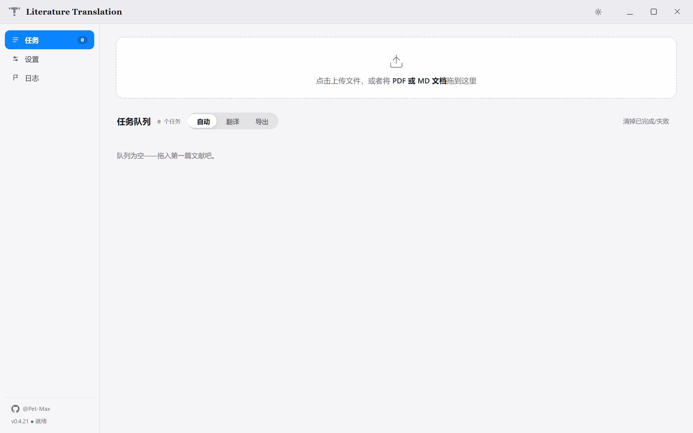
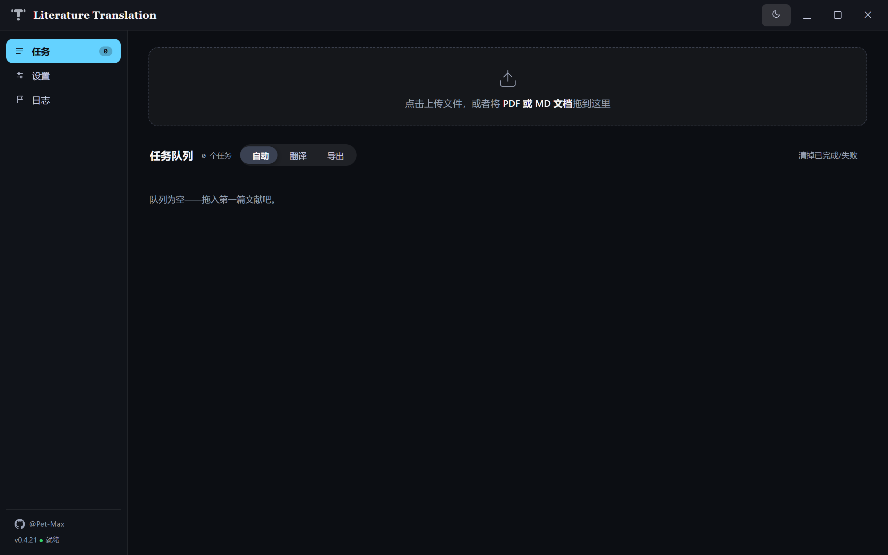

<p align="center"></p>

<h1 align="center">Literature Translation</h1>

<p align="center"><b>它什么也没说，直接甩来一篇译文——“孩子，你有救了”</b></p>

<p align="center"><b>英文学术文献翻译桌面应用</b> —— PDF / MD 拖入即翻，产出带公式、图表、参考文献的中文 PDF</p>

<p align="center"><b>看看效果</b>：<a href="samples/example-document-en.pdf">英文原文</a> 与 <a href="samples/example-document-cn.pdf">中文译文</a>——虚构示例，非真实文献</p>

<p align="center">
  <a href="https://go.dev"></a>
  <a href="https://wails.io"></a>
  <a href="https://github.com/Pet-Max/Literature-Translation/releases"></a>
  <a href="https://github.com/Pet-Max/Literature-Translation/releases/latest"></a>
  <a href="LICENSE"></a>
</p>

## 界面预览

| 浅色主题（默认） | 深色主题 |
|:-:|:-:|
|  |  |

## 主要功能

- **智能路由**：按语言自动分流——英文 PDF 全流程、英文 MD 直接翻译、中文 MD 仅导出、中文 PDF 秒拒
- **解析校准**：以原 PDF 文本层为参照，自动修复解析损伤（符号、拼写、真词、重音符、控制码、数学伪影、上下标）；HTML 表格自动转 Markdown，可离线重跑
- **公式零损伤**：公式整体冻结、原样保留，机械校验不合格自动重试；公式横线贴近 LaTeX 印刷粗细
- **规则与术语**：内置「物理」与「通用学术」双预设，多套规则可编辑切换；术语表统一译名
- **双语对照**：译文段落后附原文，方便核对
- **断点续跑**：译文即时落盘，中断重跑自动跳过已完成段
- **文献归档**：每篇一个档案夹，四类产物与过程文件全保留——`01_en_pdf` 原文 PDF · `02_en_md` 英文 MD · `03_zh_md` 中文 MD · `04_zh_pdf` 成品
- **自动保存**：设置改动即时落盘，关闭窗口前自动收尾未保存的修改
- **字体与主题**：三套字体方案（文楷内嵌）+ 自定义导入；浅深双主题一键切换

## 快速开始

### 下载安装

前往 [GitHub Releases](https://github.com/Pet-Max/Literature-Translation/releases) 下载（发布后两个形态都有）：

- **安装版** `Literature-Translation-Setup-*-windows-amd64.exe`——安装向导、自定义目录、开始菜单与卸载器
- **便携版** `Literature-Translation-*-windows-amd64-portable.zip`——解压即用，程序与归档自包含

安装前可用[依赖检测脚本](https://github.com/Pet-Max/Literature-Translation/blob/main/scripts/depscheck.bat)一键检查 WebView2 与 Edge——脚本负责诊断，[常见问题](#常见问题)里的修复步骤与官方下载链接负责对症。对于下载脚本，打开页面后点「Download raw file」按钮保存即可；脚本为 GBK 编码，网页预览乱码属正常，下载运行不受影响。

### 从源码构建

#### 环境要求

| 组件 | 说明 |
|------|------|
| Windows 10 / 11 | 目前仅支持 Windows（WebView2 与 Edge 系统内置，精简系统除外，见[常见问题](#常见问题)） |
| Go 1.26+ | 构建主程序（翻译引擎内置，无需 Python） |
| [MinerU](https://mineru.net) 账号 | 精准解析 API Token |
| 任意 OpenAI 兼容 LLM | 模型 API 地址 + API Key + 模型名 |

#### 构建

```bat
scripts\build.bat
```

产物在 `build/bin/Literature-Translation.exe`

### 首次配置

1. 启动应用，进入「设置 → 服务连接」
2. 填入 MinerU API Token（点「前往 API 管理 ↗」直达获取页）
3. 填入 LLM 模型 API 地址、API Key、模型名（可点「拉取模型」从上游列表选择）
4. 点输入框右侧 ⇄ 图标测试连通，两个 ✓ 就绪
5. 改动自动保存——卡片右上角出现 ✓ 已保存即生效

### 使用

1. 拖入 PDF 或 MD 文件（多文件可一次拖入）
2. 按需切换入队模式：自动 / 翻译 / 导出
3. 点「开始」——队列串行处理，可暂停 / 单卡优先
4. 完成后点「中文 PDF」打开成品，「打开文件夹」直达归档目录

**进阶：用环境变量管理密钥（可选）**

四个凭据字段支持环境变量，且优先级高于配置文件，设置后重启应用生效：

| 字段 | 环境变量（按生效优先序） |
|------|--------------------------|
| MinerU Token | `MINERU_TOKEN` → `MINERU-TOKEN` → `MINERU_API_TOKEN` |
| LLM Key | `LLM_API_KEY` → `OPENAI_API_KEY` |
| LLM 地址 | `LLM_BASE_URL` → `OPENAI_BASE_URL` |
| LLM 模型 | `LLM_MODEL` → `OPENAI_MODEL` |

注意：设置按字段自动保存；环境变量注入的值若未经编辑，不会写入 `config.json`。

## 常见问题

- **双击 exe 弹出 SmartScreen 警告？** 应用未做代码签名，Windows 会先行拦截，属正常情况。依次尝试：
  1. 在弹窗中点「更多信息」→「仍要运行」，多数情况下即可正常启动。
  2. 若无效：右键 exe →「属性」→ 勾选底部「解除锁定」→ 确定，重新运行。
  3. 若仍无效（部分系统弹窗中不含「仍要运行」按钮）：打开 Windows 安全中心 →「应用和浏览器控制」→「基于声誉的保护设置」，关闭「检查应用和文件」；若 Edge 下载亦被拦截，同时关闭「适用于 Microsoft Edge 的 SmartScreen」。运行成功后建议恢复上述开关。
- **双击 exe 后没有任何反应？** 大概率缺 WebView2 运行时（精简系统/LTSC 常见）。运行[依赖检测脚本](scripts/depscheck.bat)确认，或直接安装 [在线引导安装器](https://go.microsoft.com/fwlink/p/?LinkId=2124703)（约 2MB，需联网）；无网环境用 [离线 X64 包](https://go.microsoft.com/fwlink/?linkid=2124701)。装完无需重启，重新打开应用即可。若检测脚本提示「主文件缺失」，重新运行引导安装器覆盖修复即可。
- **提示找不到 Edge 或 Chrome？** 导出 PDF 依赖 Edge（Win10/11 内置）或 Chrome 任一，仅影响导出，其他功能不受影响。检测到 Chrome 时导出自动改用 Chrome，无需安装；两者皆无时，可运行[依赖检测脚本](scripts/depscheck.bat)确认，或[安装 Edge](https://www.microsoft.com/edge/download)，无需任何配置。
- **翻译引擎报错？** 翻译引擎内置于应用内；若报 LLM 相关错误，先检查设置页的 LLM 地址/Key/模型名。
- **MinerU 报 Token 无效 / A0202？** 到 [mineru.net「API 管理」](https://mineru.net/apiManage/token)重新生成 Token，回设置页粘贴后点输入框右侧 ⇄ 重测。
- **翻译卡住或某段失败？** 先看「日志」视图——解析、重试、导出的全过程都在。个别段最终失败会保留英文原文并标注，处理完直接重跑，自动断点续译。

## 隐私与安全

- 凭据保存在本机 `%APPDATA%/Literature Translation/config.json`，不上传、不遥测
- 翻译内容仅经过你配置的 LLM 接口和 MinerU 云端，本工具自身不收集任何数据
- 断点缓存只含任务指纹、源段哈希、译文与失败原因，不含 API Key

## 开发指南

```
main.go        GUI 入口（Wails v2，go:embed 前端资源）
app/           Wails 绑定层（队列、设置、连接测试、恢复、字体导入）
cmd/literature-translation/   CLI 入口（与 GUI 共用 internal/pipeline）
internal/      能力包：config / pipeline / engine（内置 Go 翻译引擎：切段→冻结→
               翻译→校验→回填）/ pdftext（PDF 文本层）/ mineru / render /
               export / fonts / repair / version（版本号唯一定义）
frontend/dist/ 前端源码，零构建（embed 进主程序）
tests/         管线 E2E、前端 E2E、overlay 服务器、gui_shim 模拟壳
build/         图标源与打包产物（bin/ 不入库）
```

### 命令行（CLI）

GUI 之外提供同能力的命令行（与 GUI 共用 internal/pipeline 管线）：

```bash
literature-translation check                       # 预检配置与环境
literature-translation run paper.pdf               # 全流程：解析 → 校准 → 翻译 → 导出
literature-translation translate doc.md            # 翻译已有 MD 并导出（跳过解析）
literature-translation print doc.md                # 仅排版导出 PDF（不翻译）
literature-translation calibrate doc.md paper.pdf  # 离线重跑解析校准（改写 MD，自动留 .bak）
literature-translation font add|list|use|remove    # 字体管理
```

### 构建与贡献

- **改前端**：直接编辑 `frontend/dist/` 前端源码文件，无构建步骤；改完 `scripts\build.bat` 重新打包（前端经 embed 进 exe）
- **打包分发**：`scripts\package.bat` 产出两种分发物到 `build\bin\`——`Literature-Translation-Setup-vX.Y.Z-windows-amd64.exe`（安装版）与 `Literature-Translation-vX.Y.Z-windows-amd64-portable.zip`（便携版），载荷 = 主 exe + LICENSE，两版同源
- **一键体检**：`scripts\check.bat`（vet / workflow lint / go test 含管线 E2E / 前端 E2E），全部本地运行，不需要真实 LLM Key 与 MinerU 配额；覆盖语言路由、归档方案、字体校验、公式冻结/解冻、PDF 文本抽取、解析校准全链路、断点续跑、前端交互与主题
- **单独跑的两项**：模糊测试 `go test ./internal/pipeline -fuzz FuzzNewArchivePlan -fuzztime 30s`（种子语料随 go test 常跑，深挖用 -fuzz）；前端组件 E2E `npm ci && node tests/e2e_frontend.mjs`（Playwright 驱动真实前端 + mock 壳，需 Chrome/Edge）
- **欢迎 PR**：fork → 建分支 → `scripts\check.bat` 四步全绿 → 提 PR（CI 自动跑同一套门禁、不产出安装包）。约定：gofmt 零告警；新增 Go 绑定必须在 shim（`tests/gui_preview/gui_shim.js`，window.go 的 mock，由 `tests/overlay_server.mjs` 注入）里加同名 mock，否则前端测试挂；归档目录常量在 `internal/pipeline/outputplan.go`，默认规则文本在 `internal/config`

## License

[MIT](LICENSE)
## 友情链接

[LINUX DO](https://linux.do) ——欢迎佬友交流使用体验、反馈问题

## 致谢

没有以下功能，这款软件是不可能实现的：

| 项目                                                         | 许可               | 用途                       |
| ------------------------------------------------------------ | ------------------ | -------------------------- |
| [Wails v2](https://wails.io)                                 | MIT                | Go 桌面框架                |
| [KaTeX](https://katex.org)                                   | MIT                | 公式排版引擎（内嵌）       |
| [霞鹜文楷](https://github.com/lxgw/LxgwWenKai)（[webfont 打包](https://github.com/chawyehsu/lxgw-wenkai-webfont)） | SIL OFL 1.1 / MIT  | 内嵌中文字体               |
| [PDFium](https://pdfium.googlesource.com/pdfium/)（经 [go-pdfium](https://github.com/klippa-app/go-pdfium) 内嵌 wasm） | BSD-3-Clause / MIT | 引擎的 PDF 文本层抽取 |
| [MinerU](https://mineru.net)                                 | 云服务             | 文档精准解析               |

